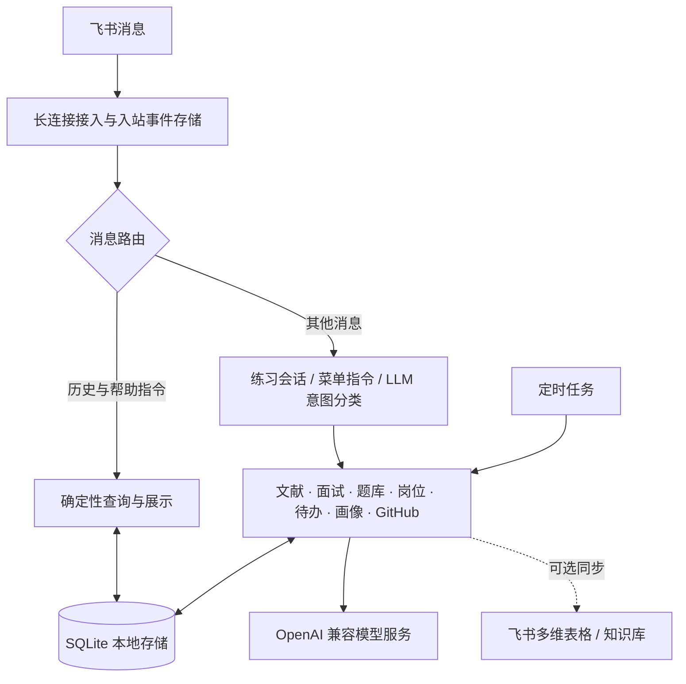

<a id="top"></a>

<div align="center">

# 🤖 飞书个人助手

**把文献阅读、求职准备和日常事务，放进一个聊天窗口。**

在本机运行，通过飞书使用的 AI 助手。
支持多轮对话、文献解读、模拟面试、待办提醒，以及可查看、可搜索的对话历史。


[](LICENSE)

[功能一览](#features) · [对话历史](#history) · [快速开始](#quick-start) · [架构设计](#architecture) · [测试验证](#tests)

</div>

---

你可以把论文 PDF 发给它，围绕研究方向继续追问；也可以粘贴一份 JD，准备简历和模拟面试。聊过的内容保存在本机，需要回顾时，直接在飞书中查看或搜索。

本项目基于 [wangziyingly/feishu-personal-assistant](https://github.com/wangziyingly/feishu-personal-assistant) 进行增量开发。本版本重点完善**历史查询、配置安全和交互反馈**，保留原有功能与 MIT 署名。

<a id="features"></a>

## ✨ 一个入口，四类场景

| 场景 | 可以做什么 | 试着这样说 |
| :--- | :--- | :--- |
| 📚 **科研文献** | 研究需求检索、PDF 解读、文献汇报、本地文献库、论文日报 | `帮我找多智能体方向的论文` |
| 💼 **求职准备** | JD 匹配、简历优化、面经整理、题库练习、模拟面试、错题复盘 | `模拟一场后端开发面试` |
| 🗓️ **日常事务** | 自然语言待办、定时提醒、个人画像、GitHub release 订阅 | `明天下午3点提醒我交周报` |
| 💬 **对话管理** | 命名会话、新建与切换、历史分页、跨会话关键词搜索 | `搜索历史 简历` |

<details>
<summary><strong>展开查看完整功能</strong></summary>

### 科研文献

- 按研究需求扩展检索词，从 arXiv / Semantic Scholar 获取论文，并由模型辅助排序与解读。
- 发送 PDF 获取结构化总结；通过「汇报第1篇」继续生成文献汇报。
- 将文献保存在本地，支持标签、追问和已有内容复用。
- 订阅研究方向，按设定时间接收论文日报。

### 求职准备

- **岗位匹配**：解析 JD，结合个人背景给出匹配分析与准备建议。
- **面经整理**：从文本、链接或截图提取题目与参考答案，归档到题库。
- **面试准备**：定制简历、自我介绍、求职信和简历问诊。
- **实战练习**：多轮模拟面试、题库抽题、薄弱项与错题复盘。
- **可选归档**：对接飞书多维表格和知识库。

### 日常事务

- 创建待办、到点提醒、每日待办早报。
- 保存研究方向、目标岗位和简历要点，供相关功能使用。
- 订阅 GitHub 仓库的新 release，并接收中文解读。
- 识别面经、JD、简历截图中的文字；需配置支持图片输入的模型。

</details>

<a id="history"></a>

## 💬 让聊过的内容，找得回来

原项目已支持多对话存储，本版本在此基础上补齐了面向用户的历史查询入口。

| 指令 | 效果 |
| :--- | :--- |
| `对话历史` | 查看当前对话的最新一页，包含时间、角色与内容摘要 |
| `对话历史 2` | 查看更早的记录，每页 10 条消息 |
| `搜索历史 简历` | 搜索自己全部会话，显示最新 10 条匹配消息 |
| `帮助` 或 `/help` | 查看中文指令说明 |

**使用流程示意**：

```text
① 围绕「求职准备」聊简历、项目和面试
                  ↓
② 发送「对话历史」，回顾当前话题
                  ↓
③ 发送「搜索历史 简历」，定位其他会话里的相关内容
                  ↓
④ 通过「对话列表」和「切换到第2个」继续之前的话题
```

这部分采用确定性指令处理：**不调用大模型、不打断正在进行的面试或考试，也不把查询结果重复写入历史。** 即使模型未配置，历史查询和帮助仍可使用。

> **记录如何保存？** 新消息的完整文本保存到 SQLite；发给模型的上下文仍限制为最近 10 轮、每条最多 500 字。历史界面展示约 180 字摘要，搜索可匹配已保存的完整文本。旧版本已截断的内容无法恢复；PDF 和图片沿用占位文本及助手回复的记录方式。

历史查询仅在与机器人的**私聊**中回显，按飞书用户 ID 限定查询范围。关键词长度为 1–100 字；`%`、`_` 和反斜线按字面检索。搜索结果超过 10 条时，可用更具体的关键词缩小范围。

<a id="quick-start"></a>

## 🚀 快速开始

准备 Python 3.11、飞书自建应用，以及一个 OpenAI 兼容模型服务的访问凭证。本机运行期间需要联网；长连接接收消息无需配置公网回调服务器。

### 1. 配置飞书应用

在 [飞书开放平台](https://open.feishu.cn/) 创建自建应用，并完成以下设置：

| 设置 | 内容 |
| :--- | :--- |
| 应用能力 | 开启机器人 |
| 消息权限 | `im:message`、`im:message:send_as_bot`、`im:resource` |
| 事件订阅方式 | 使用长连接接收事件 |
| 订阅事件 | `im.message.receive_v1` |
| 凭证 | 获取 App ID 和 App Secret，保存在本机 |
| 发布 | 创建并发布应用版本，确认应用可用范围包含自己 |

多维表格、知识库和云文档是可选能力。使用时再按实际需要配置 `bitable:app`、`wiki:wiki:readonly` / `wiki:wiki`、`docx:document` 等权限，并为应用添加相应资源访问权限。修改应用权限后需重新发布版本。

### 2. 安装依赖

获取**本增强版本**的源码并解压，在包含 `README.md` 和 `requirements.txt` 的项目根目录打开终端。

**Windows · PowerShell**

```powershell
python -m venv .venv
.\.venv\Scripts\python.exe -m pip install -r requirements.txt
Copy-Item config.example.yaml config.yaml
```

<details>
<summary><strong>macOS / Linux 安装命令</strong></summary>

```bash
python3 -m venv .venv
.venv/bin/python -m pip install -r requirements.txt
cp config.example.yaml config.yaml
```

</details>

### 3. 填写本机配置

编辑 `config.yaml`，先完成以下必需项：

| 配置项 | 说明 | 可覆盖的环境变量 |
| :--- | :--- | :--- |
| `feishu.app_id` | 飞书应用 App ID | `FEISHU_APP_ID` |
| `feishu.app_secret` | 飞书应用 App Secret | `FEISHU_APP_SECRET` |
| `llm.base_url` | 模型服务的 OpenAI 兼容接口地址 | `LLM_BASE_URL` |
| `llm.api_key` | 模型服务 API Key | `LLM_API_KEY` |
| `llm.model` | 供应商账号实际可用的模型 ID | `LLM_MODEL` |

将示例中的 `your-model-id` 替换为真实模型 ID，并确保它与 `base_url` 对应。图片识别功能需要视觉模型。

<details>
<summary><strong>可选配置与优先级</strong></summary>

| 配置节 | 用途 |
| :--- | :--- |
| `schedule` | 待办早报、论文日报的默认时间 |
| `paper` | 论文检索数量与日报篇数 |
| `bitable` | 飞书多维表格归档 |
| `wiki` | 飞书知识库归档 |
| `github` | release 轮询间隔与可选 token；token 可由 `GITHUB_TOKEN` 覆盖 |

同名环境变量优先于 YAML，**包括已设置的空字符串**。支持只使用环境变量配置必需项，其他配置使用默认值；程序不会自动加载 `.env`。完整字段说明见 [配置示例](config.example.yaml)。

</details>

### 4. 启动并开始对话

```powershell
# Windows
.\.venv\Scripts\python.exe -m feishu_assistant.main
```

```bash
# macOS / Linux
.venv/bin/python -m feishu_assistant.main
```

启动后，在飞书中找到机器人并发送 **`帮助`**。再发一条普通消息，随后发送 **`对话历史`**，即可体验新增功能。关闭程序后，机器人将停止接收消息和执行定时任务。

<a id="commands"></a>

## 🧭 常用指令

| 想做什么 | 发送示例 |
| :--- | :--- |
| 搜论文 | `我在做多智能体信用分配，帮我找最新的方法` |
| 做文献汇报 | `汇报第1篇` / `汇报 Reflexion 这篇` |
| 订阅论文 | `订阅智能体方向的论文，每天早上九点推五篇` |
| 整理面经 | `这篇面经帮我整理：……`，或直接发送截图 |
| 练习题库 | `考考我` / `考我算法类的题` |
| 分析岗位 | `帮我看看这个 JD 适不适合我：……` |
| 准备表达 | `定制简历` / `写个自我介绍` / `简历问诊` |
| 模拟面试 | `模拟一场后端开发面试` / `用题库模拟面试` |
| 复盘弱项 | `今天面试被问到：……` / `分析我的薄弱点` |
| 新增提醒 | `明天下午3点提醒我交周报` |
| 查看画像 | `个人画像` |
| 订阅仓库 | `订阅 langchain-ai/langgraph 的更新` |
| 管理会话 | `新建对话 求职准备` / `对话列表` / `切换到第2个` |
| 回顾聊天 | `对话历史` / `搜索历史 简历` |

「新建对话」会重置当前上下文，旧对话仍然保留，可通过列表切换回来。

<a id="architecture"></a>

## 🧩 架构设计



| 设计点 | 实现方式 |
| :--- | :--- |
| **明确指令直接处理** | 历史查询先于模型和练习路由执行；原有菜单使用指令表 |
| **存档与上下文分开** | SQLite 保存完整新消息，模型使用有长度限制的滚动上下文 |
| **查询与删除校验归属** | 数据库查询限定用户；删除先验证所有权，两张表在同一事务中处理 |
| **一轮对话原子写入** | 用户输入与助手回复一起提交，避免只保存半轮记录 |
| **长回复逐步展示** | 使用飞书卡片刷新展示生成过程 |
| **消息接入可恢复** | 入站事件先落库，按 message_id 去重，支持未完成事件重放 |
| **本机存储，可选归档** | SQLite 保存主要数据，多维表格和知识库用于额外索引与归档 |

<details>
<summary><strong>查看项目目录</strong></summary>

```text
feishu-personal-assistant/
├── feishu_assistant/
│   ├── main.py          # 应用入口与组件装配
│   ├── bot.py           # 飞书消息、附件、卡片与事件队列
│   ├── router.py        # 意图路由、练习状态与滚动上下文
│   ├── history.py       # 历史指令、分页、搜索与帮助
│   ├── db.py            # SQLite 数据访问与事务
│   ├── config.py        # 配置加载、环境变量覆盖与校验
│   ├── llm.py           # OpenAI 兼容模型客户端
│   ├── scheduler.py     # 提醒、日报与 release 轮询
│   ├── bitable.py       # 多维表格同步
│   ├── wiki_kb.py       # 知识库归档
│   └── modules/         # 文献、面试、题库等业务模块
├── tests/
│   ├── smoke_test.py
│   └── test_history_config.py
├── docs/
│   ├── TECH_DESIGN.md   # 原项目设计与增量说明
│   ├── DELIVERY.md      # 文件变更与上传步骤
│   └── TEST_RESULTS.md  # 测试环境与逐项结果
├── config.example.yaml
├── requirements.txt
├── README.md
└── LICENSE
```

</details>

<a id="tests"></a>

## ✅ 测试验证

**2026-10-21 验证快照：35 项冒烟测试 + 22 项新增回归测试通过，0 失败。** 这是本次交付的实测结果，不是自动更新的 CI 状态。

| 测试范围 | 结果 | 说明 |
| :--- | :---: | :--- |
| 原有本地功能链路 | 34 / 34 | 文献、面试、题库、待办、会话、定时任务等 |
| 真实论文检索 | 1 / 1 | 本次结果来自 arXiv |
| 历史与配置回归 | 22 / 22 | 分页边界、搜索隔离、事务、来源校验、存储与配置 |
| 编译与依赖检查 | 通过 | Python 编译检查、`pip check` |

在项目根目录运行：

```powershell
# 本地冒烟测试：联网项明确标记为 SKIP
.\.venv\Scripts\python.exe tests/smoke_test.py

# 历史与配置回归测试
.\.venv\Scripts\python.exe -m unittest discover -s tests -p "test_*.py" -v

# 额外开启真实论文检索
.\.venv\Scripts\python.exe tests/smoke_test.py --network
```

macOS / Linux 将解释器路径替换为 `.venv/bin/python`。完整版本与输出见 [测试记录](docs/TEST_RESULTS.md)。真实飞书收发、模型调用和云端同步仍需使用自己的凭证进行验收，本次未完成这些验证。

<a id="privacy"></a>

## 🔐 配置与数据边界

- **凭证不进仓库**：真实配置使用本机 `config.yaml` 或环境变量。`.gitignore` 排除了配置、环境文件、数据库、日志、数据目录和备份；它不能清除已经提交的秘密。
- **本机数据是明文**：`data/assistant.db` 保存会话、画像、待办和入站事件等，附件位于 `data/pdfs/`。当前没有数据库加密或自动过期机制。
- **AI 功能会访问外部服务**：相关输入和部分上下文会发送给所配置的模型服务。历史查询不调用模型，但查询结果仍经飞书发送；可选归档会同步材料至飞书资源。
- **删除有明确范围**：删除对话会移除对应会话消息，不会同时清除独立业务记录、入站事件或飞书端消息。新增历史查询的私聊限制不代表其他原有功能已完成全面的群聊隐私加固。

<details>
<summary><strong>常见问题</strong></summary>

| 问题 | 排查方向 |
| :--- | :--- |
| 机器人没有回复 | 检查程序是否运行、应用是否发布、可用范围、消息权限和长连接事件订阅 |
| 帮助能用，AI 功能失败 | 检查模型接口地址、密钥、模型 ID、网络和账号额度 |
| 配置填了却没有生效 | 检查同名环境变量是否覆盖了 YAML，包括空值环境变量 |
| 历史中长内容只显示一部分 | 界面展示摘要；新消息完整文本仍在本机数据库中，旧版截断内容无法恢复 |
| 群里无法查看历史 | 历史回显仅允许机器人私聊，请到私聊发送指令 |

</details>

<a id="credits"></a>

## 🙌 致谢与许可

感谢 [wangziyingly](https://github.com/wangziyingly) 开源原项目。本版本沿用其文献、求职、待办等核心能力，在已有会话存储基础上扩展历史查询，并完善配置校验、交互说明和回归测试。

本次具体变更见 [交付说明](docs/DELIVERY.md)，设计背景见 [技术文档](docs/TECH_DESIGN.md)。

项目遵循 [MIT License](LICENSE)，保留原作者版权声明。

---

<div align="center">

**从一句「帮助」开始，让助手融入你的日常。**

[回到顶部 ↑](#top)

</div>
